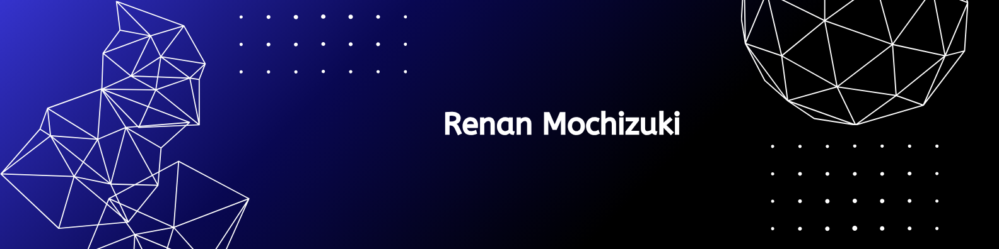

 

<h2 align="left">👋 Renan Mochizuki</h2>

 

  Faça uma breve apresentação sua com o seu nome e não esqueça a <strong>sua stack</strong>. 
  Diga o que você está fazendo no momento, se trabalha ou estuda.

  🦄 Linguagens: <strong>Coloque as linguagens que você desenvolve.</strong>

  💼 Ferramentas: <strong>Coloque as suas ferramentas de trabalho.</strong>

  💌 Aqui vai uma mensagem para entrar em contato com você: ⤵️

#### Ferramentas

  
  
  

<!--
<h2 align="left">👋 Renan Mochizuki</h2>

###

    💻 Sou um desenvolvedor Back-end 
    🔨 Determinado a superar e resolver desafios 
    🎯 Aprimorando minhas habilidades e conhecimentos 
    📗 Cursando Sistemas de Informação na USP-EACH

###

<h2 align="left">🛠️ Linguagens e ferramentas</h2>

###

    
    
    <picture>
      <source media="(prefers-color-scheme: dark)" srcset="https://github-used-languages.vercel.app/Renan-Mochizuki?theme=dark&config=config.json">
      
    </picture>

###

    
    
    
    
    
       
    
    
    

###

<h2 align="left">✉️ Contato</h2>

###

    
    

####

-->
